# Sentinel — protótipo de clareza da campanha

**Objectivo.** Resolver, numa demonstração isolada, os três problemas do primeiro playtest:
informação a mais no mapa, assuntos pendentes pouco visíveis e deslocações difíceis de acompanhar.

**Limites respeitados.** Nada disto está integrado na produção. Não foram alterados simulação, IA,
economia, geração do mapa, distâncias, combates nem gravações. Não há merge nem commit.
`git status` mostra apenas `?? artifacts/`.

A demonstração corre **por cima** da campanha real, no browser, com `demo.js` + `prototipo.css`
injectados. Os números e os textos vêm das regras existentes (`flow.preview`, `flow.previewTribute`,
`levyTribute`, `marchDays`, `foodPerDay`, `buildIssues`, `eventText`); só o estado de demonstração
(um pedido de tributo e comida baixa) é posto à mão, e está assinalado como *fixture*.

---

## 1. A · Eventos e decisões

### O que falha hoje

O único pedido que exige resposta — o tributo de Roma — vive na coluna de assuntos, com 320 px.
A 844×390 a coluna mostra o título, o contexto e o primeiro botão; **Recusar fica abaixo da dobra**.
Não há sinal explícito de que o tempo parou nem separação entre «o que acontece» e «o que podes fazer».

| Antes (assunto na coluna) | Depois (painel central) |
|---|---|
| 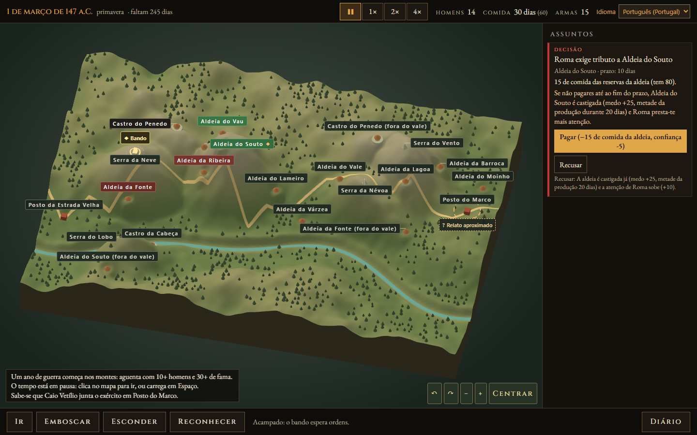 | 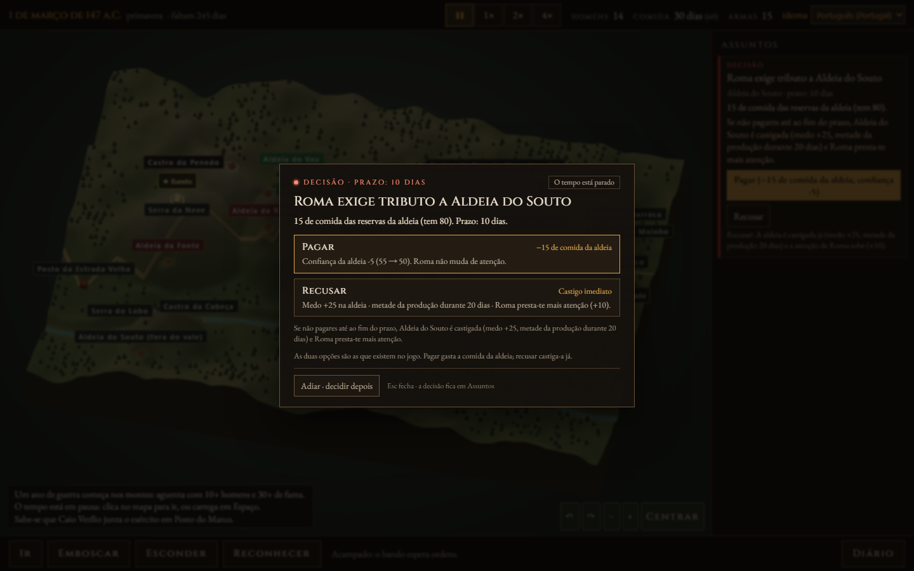 |

### Proposta

Um painel central só para assuntos `kind: 'decisao'` (`buildIssues`). Mostra, por esta ordem:

1. **etiqueta** «Decisão» + prazo real (`c.due.day − state.day`) + selo «O tempo está parado»;
2. **título** (`ISSUE.tributeTitle`);
3. **contexto curto** — comida devida e reservas da aldeia (`ISSUE.tributeWhat`);
4. **as duas opções que o jogo já tem** — Pagar e Recusar (`issues.js`), cada uma com o custo e o
   efeito conhecido:
   - Pagar: `−c.due.food` de comida da aldeia e a variação de confiança calculada por
     `flow.previewTribute('pagar', id)` (mostra `55 → 50`); Roma não sobe a atenção;
   - Recusar: medo real da pré-visualização (`refuse.state.communities[id].fear − c.fear`),
     `PUNISH.days` dias a metade da produção e `ATTENTION_GAIN.tributo` de atenção;
5. **a consequência de não decidir** (`issue.consequence`, já existente);
6. **Adiar** — fecha o painel e deixa a decisão em Assuntos; **Esc** faz o mesmo.

As acções chamam exactamente `flow.payTribute` / `flow.refuseTribute`. Não há opções novas,
nem números inventados, nem uma terceira via. Depois de decidir, o painel fecha, o assunto
desaparece e o resultado real aparece numa confirmação curta. O tempo continua em pausa até o
jogador carregar em ▶ (a demonstração não o retoma sozinha).

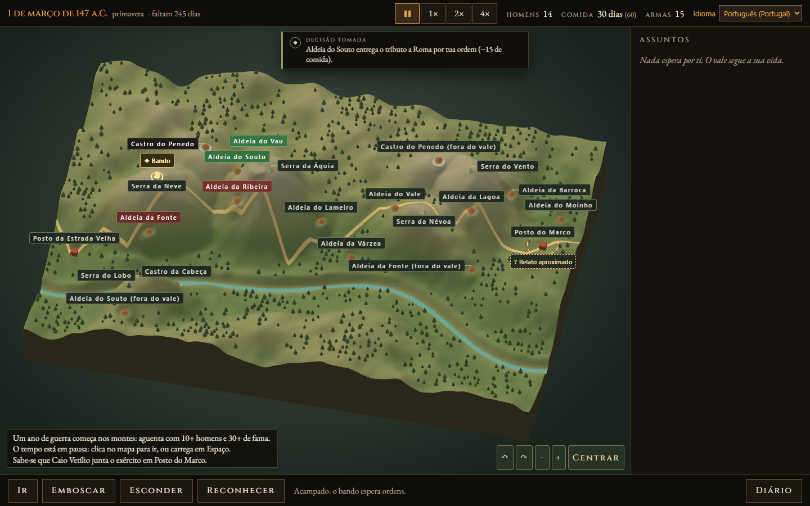

### Fluxo do evento obrigatório

1. **Assunto** — o pedido entra em `Assuntos` e o tempo pára (`campaign.running === false`).
2. **Painel** — abre com foco no primeiro botão; Tab fica preso no diálogo; Esc/Adiar não resolve.
3. **Decisão** — Pagar ou Recusar executa a regra; o assunto sai da lista; a confirmação mostra o
   evento real (`Aldeia do Souto entrega o tributo a Roma por tua ordem (−15 de comida).`).

### Notificação discreta (acontecimentos sem decisão)

Os acontecimentos do dia já têm texto em `eventText` (espera, avistamento, relato, colheita…).
A proposta não os transforma em tarefas: uma linha no topo, 7 s, `role="status"` / `aria-live="polite"`,
sem levar o foco e no máximo uma de cada vez. As decisões nunca aparecem como notificação.
(Na demonstração o aviso fica 120 s, para a captura; em produção seriam 7 s.)


A frase da captura é um dia real: `Esperas na estrada: ninguém passou. Comida: −2.`

---

## 2. B · Mapa mais limpo

Quatro estados, todos sobre a mesma campanha (seed 1234, dia 7), para a comparação ser justa.

### 1. Mapa actual

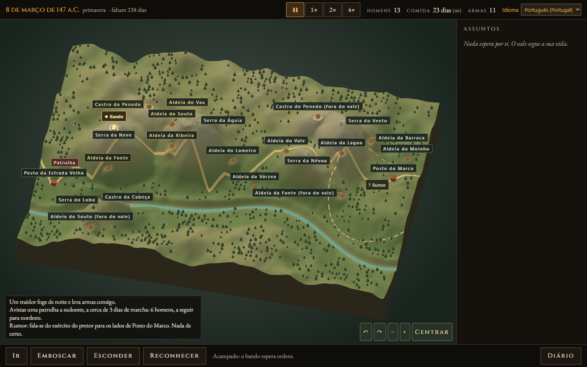

25 etiquetas visíveis a 1440×900: 5 comunidades, 17 lugares secundários (serras, aldeias fora do
vale, castros, postos), 1 força, 1 zona de rumor e o bando. A maior parte do texto não pede nada ao
jogador.

### 2. Informação essencial

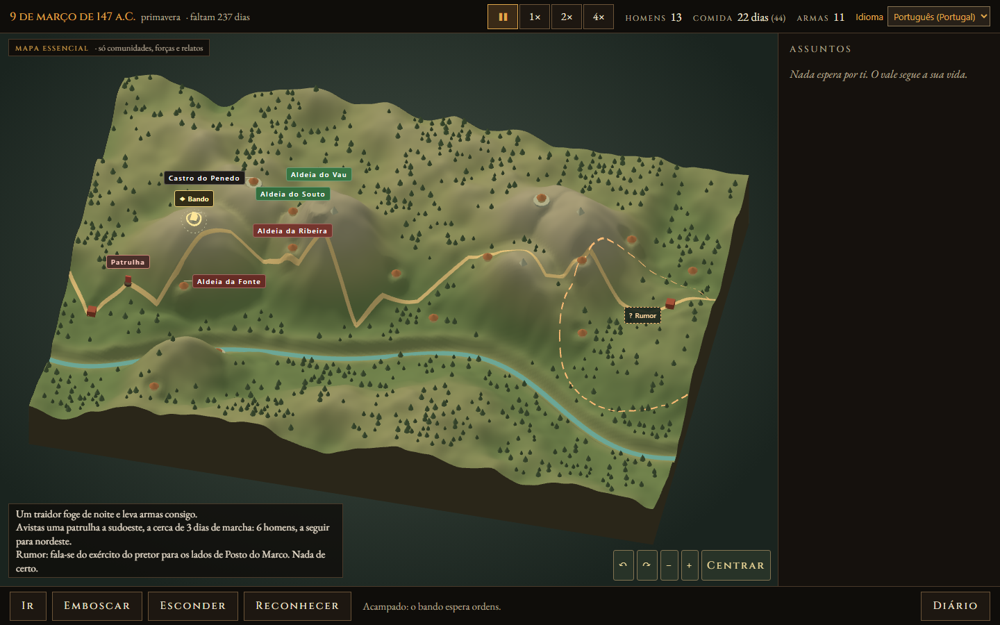

**Fica:** as 5 comunidades, o bando, **todas** as forças romanas conhecidas, a zona de rumor e as
etiquetas de estado que o jogo já usa. **Sai:** tudo o que é terreno ou povoação sem comunidade —
serras e aldeias que não recrutam nem ajudam (17 etiquetas a 1440). Postos e castros continuam
seleccionáveis pelo Diário → Lugares; essa entrada tem de ficar explícita na produção.

A distinção de informação **não** é achatada: forças confirmadas mantêm o estilo actual, as
estimadas mantêm o contorno tracejado e a idade («vista há N dias»), e a zona de rumor mantém o
traço laranja e o «?». O modo essencial só retira rótulos secundários.

O fundo das etiquetas de comunidade passa a indicar o alinhamento político (secção seguinte). Em
1280/1024/844 o layout ainda não coloca as cinco: aparece então uma linha **«Comunidades · N de 5
no mapa»** com um select que leva à povoação escolhida pelo mesmo `pick()` do mapa. O select não é
um novo dado: lista as cinco comunidades reais e abre o painel real, mesmo quando a etiqueta está
escondida. É o compromisso explícito desta entrega.

### 3. Força romana seleccionada

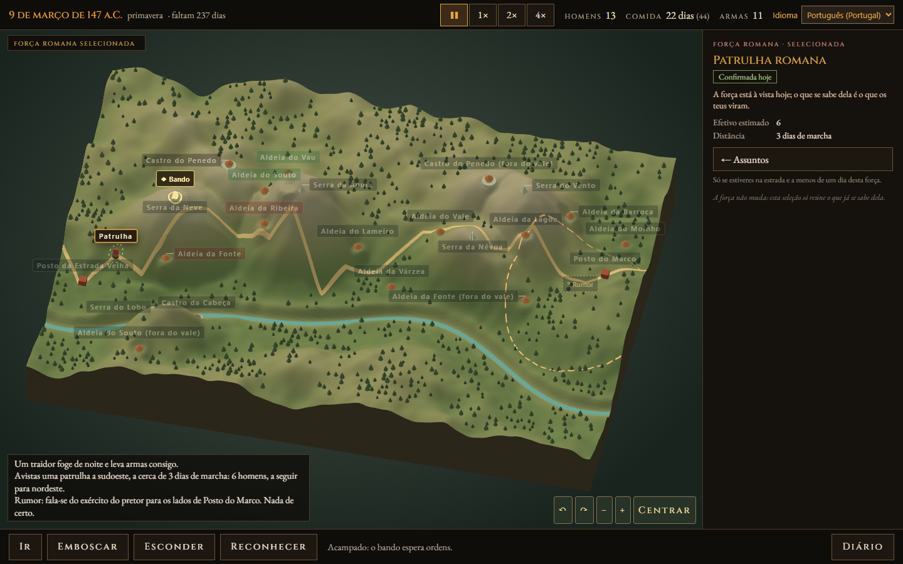

Clicar a força continua a fazer o que o jogo já faz (foco no mapa). A proposta acrescenta um cartão
na coluna: nome, **Confirmada hoje** ou **Estimada · vista há N dias**, efectivo estimado
(`estimateMen`), distância em dias de marcha (`marchDays`) e uma única acção existente —
**Emboscar na estrada**, mostrada apenas quando `distância ≤ MARCH_SPEED` **e** `nearRoad` são
verdadeiros, tal como em `issues.js`. Fora dessas condições, o cartão diz porquê em vez de inventar
uma acção. As restantes etiquetas recuam para 34% de opacidade; a força escolhida ganha bordo.

### 4. Povoação seleccionada

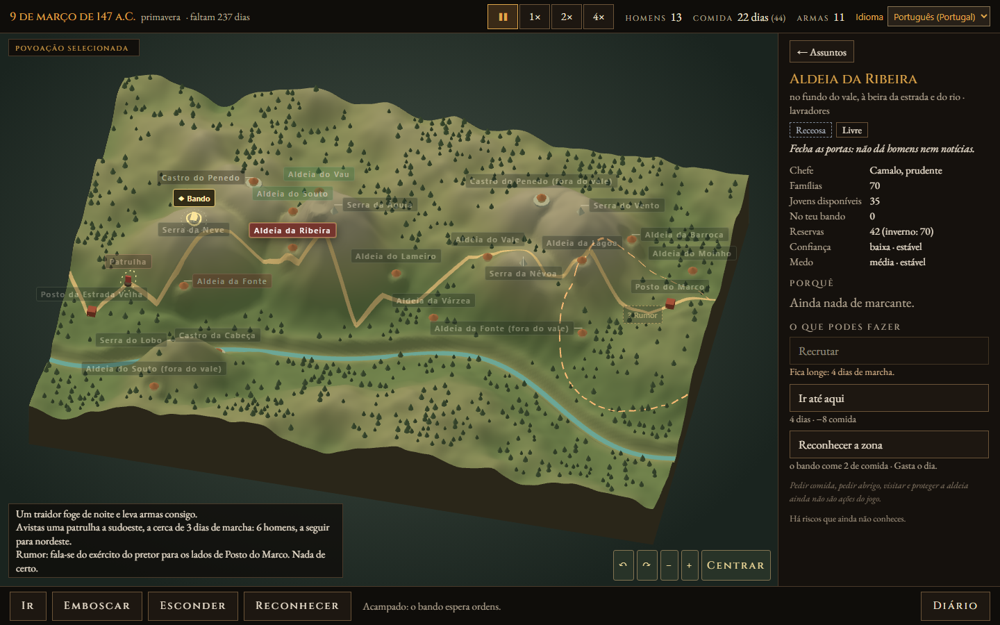

O painel existente mantém-se (postura, situação, famílias, jovens, confiança, medo, motivos,
acções e pré-visualizações). A mudança é só de foco: a etiqueta escolhida fica destacada e as
outras recuam, para o mapa deixar de competir com o painel.

### Alinhamento político das etiquetas

Não existe um campo `apoio` separado no estado. O estado político existente é `community.posture`, calculado a
partir da margem `trust − fear` (com histerese) em `communities.js`. O fundo usa **a postura para o lado** e
**a margem para a intensidade**, para que «mais forte» seja mais escuro sem inventar um novo valor:

| Postura | Margem `trust − fear` | Lado | Fundo | Leitura |
|---|---|---|---|---|
| `comprometida` | ≥ 40 | Viriato | verde escuro | apoio forte ao bando |
| `amiga` | 15 … 39 | Viriato | verde médio | apoia o bando |
| `neutra` | −14 … 14 | Independente | preto/cinzento muito escuro | não escolheu lado |
| `receosa` | −39 … −15 | Roma | vermelho médio | alinhada por medo, não por convicção |
| `colabora` | ≤ −40 | Roma | vermelho escuro | colabora com Roma |

A intensidade é interpolada dentro de cada lado pela margem normalizada; os valores da tabela são as âncoras.
O texto do nome passa a branco (`#fff`) em todas as etiquetas de comunidade. Não se altera a tipografia, o
tamanho, o `padding` nem se acrescentam ícones. `situation` (tributada, castigada, ocupada…) **não** entra:
é o que Roma fez à aldeia, não o lado que ela escolheu. `receosa` é o compromisso assumido: é vermelho porque
está alinhada com Roma na prática, mas mais claro do que `colabora`, que é apoio activo.

Resultado medido no estado real (dia 7, pt-PT):

| Comunidade | Postura | Fundo | Contraste do nome |
|---|---|---|---|
| Aldeia da Fonte | `colabora` | `rgb(102, 44, 37)` | 10,76 |
| Aldeia da Ribeira | `receosa` | `rgb(117, 53, 45)` | 9,12 |
| Aldeia do Vau | `amiga` | `rgb(56, 118, 67)` | 5,47 |
| Castro do Penedo | `neutra` | `rgb(30, 27, 24)` | 17,14 |
| Aldeia do Souto | `amiga` | `rgb(51, 110, 62)` | 6,10 |

Todos acima de 4,5:1. O exemplo com os cinco degraus (`comprometida` incluída) está em
`11-politica-1440x900.png`; é uma fixture declarada, com Souto a `comprometida` por margem 70. A
captura `02-mapa-essencial-1440x900.png` usa o estado real, sem fixture.

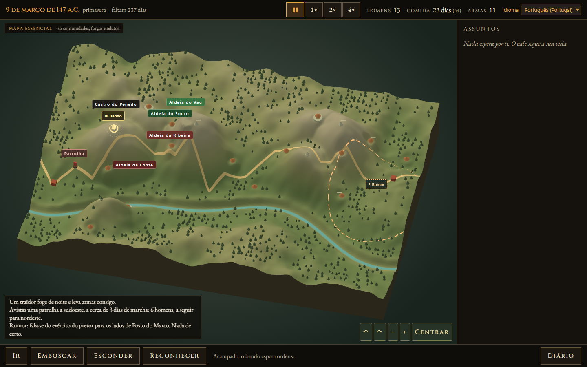

### O que a validação revelou

| Resolução | Etiquetas visíveis (actual → essencial) | Comunidades visíveis no essencial | Acesso alternativo |
|---|---|---|---|
| 1440×900 | 25 → 8 | **5 / 5** | não precisa |
| 1280×800 | 23 → 7 | 4 / 5 | sim (4 de 5) |
| 1024×600 | 17 → 6 | 3 / 5 | sim (3 de 5) |
| 844×390 | 11 → 4 | 2 / 5 | sim (2 de 5) |

Zero sobreposições e zero etiquetas cortadas em todos os casos medidos. A 844 o total inclui a
força confirmada e o bando; sem força, a camada essencial mostrava 3 comunidades (testado no dia 0).

**O layout continua a ser o bloqueador.** O `positionLabels` de `scene.js` esconde etiquetas que
não cabem; ao remover os rótulos secundários, sobram colisões com a força confirmada e entre
comunidades vizinhas. Testei esconder a etiqueta do bando: não libertou uma única comunidade
(4/3/2 continuavam), porque a colisão não é com ela. A demonstração não promete «cinco etiquetas
sempre visíveis»: garante o acesso às cinco pela linha de comunidades e reserva a prioridade de
layout para a implementação.

A produção deve:

- reservar espaço para as cinco etiquetas antes de colocar as restantes; ou
- um layout de etiquetas em duas filas/coluna com linhas-guia em ecrãs pequenos; e
- manter a força e o rumor sempre visíveis (não se resolveu escondendo ameaças nem com zoom global).

O select alternativo aparece só quando `visibleCommunities() < 5`. A 1440 a linha não aparece; a
1280/1024/844 aparece com a contagem real. A 844 fica por cima da etiqueta do bando (limitação
visual menor do fallback); não esconde comunidades nem forças.

---

## 3. C · Feedback de marcha

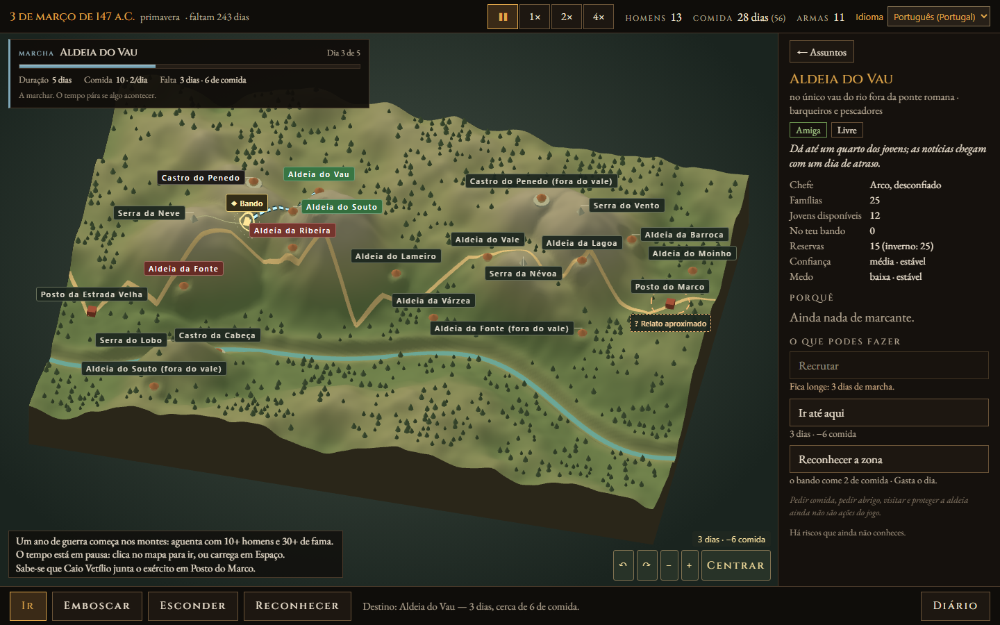

Uma faixa compacta, por baixo da barra de cima, com os números que a interface já calcula:

- **Destino** — nome real do lugar (`marchDays` + `placeName`);
- **Duração** — `marchDays(world, party, dest)` dias;
- **Comida** — total `dias × foodPerDay(men)` e o consumo por dia;
- **Progresso** — dias feitos / total, calculado pela posição real do bando, não por um relógio;
- **Falta** — dias e comida restantes;
- **Interrupção** — quando `campaign.interrupt` tem motivos (ou a fase deixa de ser `mapa`), a faixa
  passa a «Interrompida», o tempo pára e o motivo real aparece por baixo.

Exemplo medido: **Aldeia do Vau, 5 dias, 10 de comida (2/dia)**; ao terceiro dia, **2 de 5**, restam
**3 dias · 6 de comida**. A faixa desaparece quando não há destino.


A interrupção da captura é real: um dia de marcha com `food = 2` faz `detectInterruptions` disparar
`comida`, o tempo pára e o motivo é «O bando ficou sem comida.». A regra não foi tocada; só o estado
da demonstração foi posto nesse ponto.

### Defeito encontrado

Com uma povoação seleccionada, `renderIssues` esconde `#missues` **e com ela `#m-int`**. Durante a
marcha com o painel do destino aberto, o cartão real «O tempo parou» fica invisível. A faixa da
proposta cobre o sintoma (mostra o motivo), mas a produção deve dar precedência a `#m-int` ou fechar
o painel quando há interrupção.

A 844×390 a faixa passa a uma linha compacta e começa abaixo dos 67 px reais da barra (grelha do
`language.css`), não dos 42 px que a regra de `max-height: 480px` sugere:

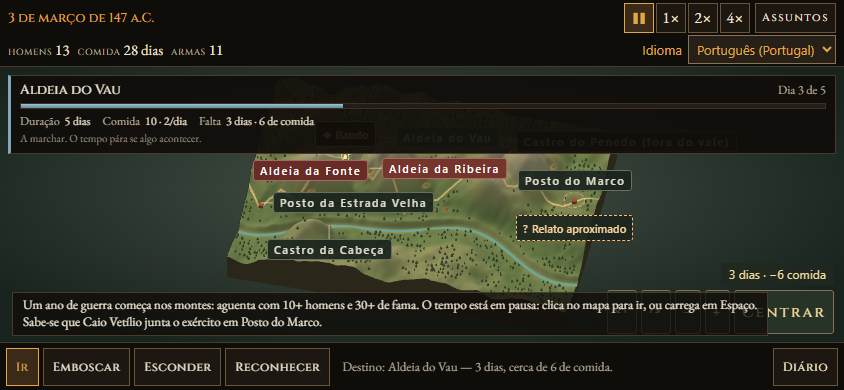

### Verificação da interrupção (M3.2-B)

Cenário integrado: tributo pendente (`levyTribute` real) + povoação seleccionada + marcha
interrompida por comida. A faixa foi medida com a coluna aberta e fechada, a 1440×900 e 844×390.

| Condição | 844×390 | 1440×900 |
|---|---|---|
| Povoação seleccionada (`#mctx` visível) | sim | sim |
| Assuntos pendentes (`.issue` no DOM) | 2 | 2 |
| Faixa visível, coluna aberta | sim | sim |
| Faixa visível, coluna fechada | sim | sim |
| Faixa sobrepõe a coluna | não (460 px de largura) | não (520 px) |
| Faixa sobrepõe a barra de cima/baixo | não | não |
| `#m-int` realmente renderizado | **não** (0 rects) | **não** (0 rects) |

A faixa encolhe para 460 px quando a coluna está aberta a 844, em vez de ficar por baixo dela.
Com a coluna fechada ocupa 828 px, mas continua abaixo dos 67 px da barra. O cartão real `#m-int`
continua escondido por `#missues` quando há povoação seleccionada — o defeito descrito acima. A
faixa mostra o motivo («O bando ficou sem comida.»), mas a produção deve dar precedência a `#m-int`
(ou fechar o painel) para não depender da faixa.

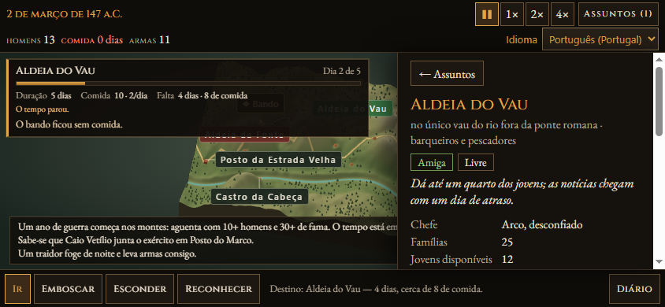

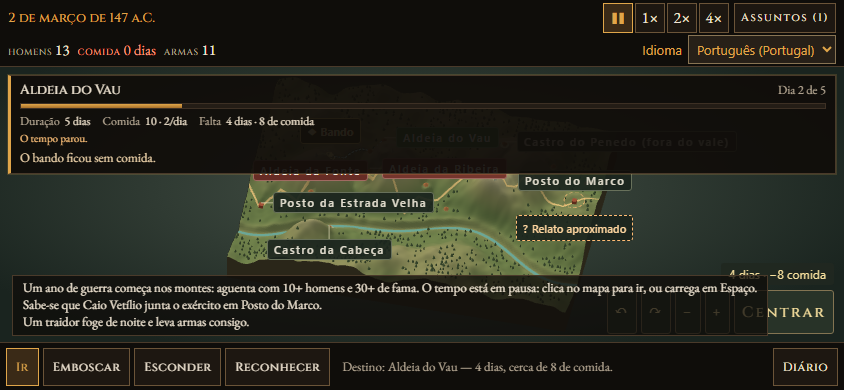

A 1440×900 a faixa mede 520×120 com o motivo e fica à esquerda da coluna:

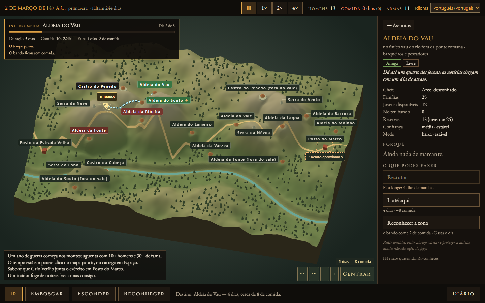

---

## 4. D · Validação

Todas as capturas em Chromium (browser cloud), com a mesma campanha e o mesmo dia para os quatro
mapas. A demonstração foi medida com `metricas()`: caixas de etiquetas, painéis, barras e contrastes.

| Critério | 1440×900 | 1280×800 | 1024×600 | 844×390 |
|---|---|---|---|---|
| Sobreposições de etiquetas (todos os estados) | 0 | 0 | 0 | 0 |
| Etiquetas cortadas | 0 | 0 | 0 | 0 |
| Painel de decisão dentro do ecrã | sim | sim | sim | sim |
| Painel de decisão precisa de scroll | não | não | não | não |
| Barra de cima / baixo | 48 / 56 px | 48 / 56 px | 48 / 56 px | 67 / 48 px |
| Transbordo da barra de cima | não | não | não | não |
| Faixa de marcha sobrepõe barras/coluna | não | não | não | não |
| Faixa com coluna aberta | 520 px, sem sobreposição | 520 px, sem sobreposição | 520 px, sem sobreposição | 460 px, sem sobreposição |
| Comunidades visíveis / acesso alternativo | 5 / 5, não precisa | 4 / 5, select | 3 / 5, select | 2 / 5, select |
| Contraste mínimo do nome da comunidade | 5,47 | 5,47 | 5,47 | 5,47 |
| Contraste título / contexto / efeito | 14,87 / 13,23 / 8,31 | idem | idem | idem |
| Contraste da faixa de marcha | 15,24 | 15,24 | 15,24 | 15,24 |

Contrastes calculados pela luminância relativa (WCAG), não por estimativa visual. Todos os textos
principais ficam acima de 4,5:1.

### Limitações da validação

- **Etiquetas**: a 1280/1024/844 o mapa essencial ainda esconde comunidades (4/5, 3/5, 2/5); há
  acesso alternativo por select. É o bloqueador descrito na secção B; não foi escondido no relatório.
  A contagem depende do idioma: em inglês, os nomes mais curtos deixam 3 comunidades a 844; em pt-PT
  ficam 2. Isso confirma que é um problema de largura/layout, não de dados.
- **Acesso alternativo**: o select foi testado a 844 (escolher a Ribeira abre o painel real), mas o
  popup nativo do select não aparece nas capturas; a linha e a contagem estão em `11-politica-844x390`.
- **Política**: `receosa` é alinhamento por medo, não apoio; foi mapeada para vermelho mais claro.
  As forças romanas mantêm o estilo confirmado/estimado e não recebem cor política.
- **Combates**: a demonstração não inicia batalhas. Numa execução intermédia, um passo de marcha
  encontrou uma patrulha e abriu batalha; as capturas finais usam campanhas novas para a marcha e
  para a interrupção, sem encontros.
- **WebGL**: o browser cloud usa renderização por software; o mapa é o mesmo, mas o desempenho não
  foi medido.
- **Idioma**: as capturas estão em pt-PT. As chaves novas estão propostas em inglês e pt-PT na
  tabela abaixo; a versão inglesa não foi capturada.
- **Testes**: nenhum ficheiro de produção foi alterado, por isso não se correu `npm test`.
  `demo.js` passou `node --check`.

---

## 5. Fluxos, passo a passo

### Evento obrigatório

| Passo | Ecrã | O que acontece |
|---|---|---|
| 1 | `05-evento-assunto` | `levyTribute` (regra real) cria o pedido; o assunto entra na coluna; o tempo pára. |
| 2 | `06-evento-painel` | O painel central abre com as opções e os efeitos reais; foco preso; Esc/Adiar mantêm a decisão. |
| 3 | `07-evento-resultado` | Pagar executa `payTribute`; o assunto desaparece; a confirmação mostra o evento real. |

### Deslocação interrompida

| Passo | Ecrã | O que acontece |
|---|---|---|
| 1 | `09-marcha` | Destino escolhido pelo painel real («Ir até aqui»); dois dias de marcha real; a faixa mostra 2/5 e 6 de comida restante. |
| 2 | `10-marcha-interrompida` | Um dia real com comida baixa dispara `detectInterruptions`; o tempo pára; a faixa mostra o motivo. |

---

## 6. Ficheiros que seriam alterados

| Ficheiro | Mudança | Porquê |
|---|---|---|
| `index.html` | Markup de `#m-decision` (diálogo), `#m-toast` e `#m-march` dentro de `#map`; ligação ao CSS novo | Os painéis precisam de existir fora da coluna de 320 px |
| `src/campaign/ui.js` | `renderDecision()` (a partir de `buildIssues`), `renderMarch()` (destino/progresso/interrupção), `renderNotification()`; `paintPolitical()` (postura + margem) e a linha de acesso às comunidades; chamadas em `render()`; foco preso e Esc; corrigir a precedência de `#m-int` em `renderIssues` | Toda a lógica de apresentação já está aqui; as regras não mudam |
| `src/campaign/strings.js` | Textos novos (ver tabela i18n) | Mantém os textos do jogo num só sítio |
| `src/i18n/catalogs/pt-PT/map.js` e `src/i18n/catalogs/en/map.js` | Chaves novas, com os mesmos `{parâmetros}` | `validateCatalogs` falha o `npm test` se faltar uma chave ou um parâmetro |
| `src/campaign-map-3d/strategic.js` | `tier: 'essencial' \| 'secundario'` por lugar (comunidade vs. resto) | O modo essencial não deve depender de classes injectadas |
| `src/campaign-map-3d/scene.js` | `priority` das comunidades acima do bando e reserva de espaço; usar `tier` para esconder | É aqui que nasce a colisão a 1024/844 |
| `src/campaign-map-3d/interaction.js` | Reserva de espaço/segunda fila para as comunidades em `positionLabels` | É o algoritmo que hoje esconde as etiquetas |
| `src/campaign-map-3d/campaign-view.css` | Estilos das etiquetas no modo essencial; fundo político; foco da selecção | Consistência com o resto do mapa |
| `tools/e2e-campaign-panels.mjs` | Asserções para o diálogo, a notificação, a faixa, o acesso às comunidades e a cor política | Proteger os identificadores e os números reais |

**Não muda:** `flow.js`, `simulation.js`, `state.js`, `rome.js`, `battles.js`, `worldgen.js`,
`communities.js`, `events.js`, `issues.js` (os dados já existem), gravações (`viriato.campaign`, v1).

### Identificadores preservados

A demonstração não altera `#missues-list`, `.issue`, `[data-act]`, `#m-int`, `#mctx`, `#mtop`,
`#mbot`, `#m-side-toggle` nem as etiquetas `.map-label` (`data-kind`, `data-id`, `textContent`).
Os elementos novos usam prefixos `cl-` / `clareza-`. O glifo de estado, quando existir, fica em CSS
(`::before`), para o `textContent` continuar só o nome — como no trabalho A1/A2.

---

## 7. Riscos e custo

| Risco | Impacto | Mitigação |
|---|---|---|
| Duas fontes para a mesma decisão (coluna + modal) | Divergência de estado | Ambas derivam de `buildIssues`; o modal fecha quando o assunto deixa de existir |
| O modal pára o tempo | O jogador perde o ritmo | O tempo já pára na interrupção; fechar/Adiar não retoma automaticamente |
| Várias decisões no mesmo dia | Fila | Uma de cada vez, por prazo; a coluna continua a ser a lista completa |
| `#m-int` escondido pelo painel da povoação | Interrupção invisível | Corrigir precedência em `renderIssues` (pré-requisito) |
| Etiquetas das comunidades a 1024/844 | Mapa essencial esconde povoações | Prioridade/reserva de espaço em `scene.js`; acesso alternativo já implementado |
| Cores políticas confundirem-se com forças romanas | Leitura errada do mapa | Só `.community` recebe cor; forças mantêm confirmado/estimado; legenda na tabela |
| `receosa` parecer apoio activo a Roma | Ambiguidade política | Vermelho mais claro e documentado como alinhamento por medo |
| Linha de comunidades sobre a etiqueta do bando a 844 | Ruído visual | Reduzir a largura do select; esconder a etiqueta do bando quando a linha aparece |
| Postos/castros fora do modo essencial | Jogador não os encontra no mapa | Diário → Lugares continua a seleccioná-los; tornar a entrada visível |
| i18n | `npm test` falha | Chaves e parâmetros iguais nos dois catálogos |
| E2E | `assertControls` falha se um controlo novo sair da barra | Manter os painéis novos fora de `#mtop`; medir com a mesma função |

**Custo estimado (um programador, com revisão):**

- **A — decisão + notificação + i18n + E2E:** 2–3 dias.
- **B — camada essencial + cartão de força + prioridade de etiquetas + política + acesso:** 2,5–3,5 dias.
- **C — faixa de marcha + interrupção + testes:** 2 dias.
- **Total: 7–9 dias.** O item que pode esticar é o layout de etiquetas a 1024/844 (+0,5–1 dia).

**Ordem recomendada:** C (2 dias, corrige um defeito real e é o menos arriscado) → A (2–3 dias) →
B (2–3 dias, depende da prioridade das etiquetas).

---

## 8. Critérios de aceitação

- [ ] Nenhuma alteração a simulação, IA, economia, geração do mapa, distâncias, combates ou gravações.
- [ ] O modal só abre para `kind === 'decisao'`; as opções e os números vêm de `issues.js` e
      `flow.previewTribute`; não há opções novas.
- [ ] Pagar/Recusar executam `flow.payTribute` / `flow.refuseTribute`; o assunto desaparece e o
      resultado é o evento real.
- [ ] Esc e Adiar fecham o modal sem resolver; a decisão continua em Assuntos; o foco fica preso
      enquanto o modal está aberto.
- [ ] A notificação só aparece para acontecimentos sem decisão; uma linha, `aria-live="polite"`,
      sem tirar o foco, uma de cada vez.
- [ ] O mapa essencial mantém as 5 comunidades, o bando, todas as forças e o rumor, e esconde só
      lugares sem comunidade; 0 sobreposições e 0 cortes nas quatro resoluções.
- [ ] Quando menos de 5 comunidades cabem, a linha «Comunidades · N de 5» abre o painel real de
      qualquer uma delas; a lista não depende de a etiqueta estar visível.
- [ ] O fundo de cada etiqueta de comunidade usa a postura (lado) e a margem (intensidade); o nome
      é branco; `receosa` é vermelho mais claro do que `colabora`. Tipografia e ícones não mudam.
- [ ] A faixa de interrupção fica visível com povoação seleccionada, coluna aberta ou fechada,
      assuntos pendentes e a 844×390, sem sobrepor a coluna.
- [ ] A força seleccionada mostra estado (confirmada/estimada), efectivo, distância e só oferece
      Emboscar quando a regra real o permite.
- [ ] A faixa de marcha mostra destino, duração, comida total e por dia, progresso e interrupção;
      os números coincidem com `flow.preview` / `route`; desaparece sem destino.
- [ ] A 844×390 a faixa e o modal começam abaixo dos 67 px reais da barra; o modal não precisa de
      scroll para mostrar as duas opções.
- [ ] `npm test` e `node tools/e2e-campaign-panels.mjs` passam; os selectores existentes mantêm-se.
- [ ] Texto novo em inglês e pt-PT, com os mesmos parâmetros.

---

## 9. Textos novos (inglês primeiro, pt-PT depois)

| Chave | English | pt-PT |
|---|---|---|
| `map.decision.tag` | Decision | Decisão |
| `map.decision.paused` | Time is paused | O tempo está parado |
| `map.decision.later` | Postpone · decide later | Adiar · decidir depois |
| `map.decision.esc` | Esc closes · the decision stays in Issues | Esc fecha · a decisão fica em Assuntos |
| `map.decision.pay` | Pay | Pagar |
| `map.decision.refuse` | Refuse | Recusar |
| `map.decision.payCost` | −{food} village food | −{food} de comida da aldeia |
| `map.decision.payEffect` | Village trust {delta} ({from} → {to}). Rome does not raise its attention. | Confiança da aldeia {delta} ({from} → {to}). Roma não muda de atenção. |
| `map.decision.refuseEffect` | Fear +{fear} in the village · half output for {days} days · Rome pays you more attention (+{attention}). | Medo +{fear} na aldeia · metade da produção durante {days} dias · Roma presta-te mais atenção (+{attention}). |
| `map.decision.note` | These are the options the game already has. | As duas opções são as que existem no jogo. |
| `map.notice.tag` | No decision required | Sem decisão obrigatória |
| `map.map.essential` | Essential map | Mapa essencial |
| `map.map.essentialNote` | only communities, forces and reports | só comunidades, forças e relatos |
| `map.force.tag` | Roman force · selected | Força romana · seleccionada |
| `map.force.confirmed` | Confirmed today | Confirmada hoje |
| `map.force.estimated` | Estimated · seen {age} days ago | Estimada · vista há {age} dias |
| `map.force.strength` | Estimated strength | Efectivo estimado |
| `map.force.distance` | Distance | Distância |
| `map.force.marchDays` | {days} of march | {days} de marcha |
| `map.force.lessThanDay` | less than a day | a menos de um dia |
| `map.force.ambushWhy` | Only if you are on the road and within a day of this force. | Só se estiveres na estrada e a menos de um dia desta força. |
| `map.march.title` | March | Marcha |
| `map.march.day` | Day {day} of {total} | Dia {day} de {total} |
| `map.march.duration` | Duration | Duração |
| `map.march.food` | Food | Comida |
| `map.march.perDay` | {n}/day | {n}/dia |
| `map.march.remaining` | Left | Falta |
| `map.march.left` | {days} · {food} food | {days} · {food} de comida |
| `map.march.status` | Marching. Time stops if something happens. | A marchar. O tempo pára se algo acontecer. |
| `map.march.interrupted` | Interrupted | Interrompida |
| `map.march.stopped` | Time has stopped. | O tempo parou. |
| `map.communities` | Communities | Comunidades |
| `map.communitiesCount` | {visible} of {total} on the map | {visible} de {total} no mapa |
| `map.communitiesPick` | Go to a community… | Ir a uma comunidade… |
| `map.politics.trust` | trust {trust} · fear {fear} · margin {margin} | confiança {trust} · medo {fear} · margem {margin} |
| `map.politics.committed` | Committed to Viriatus | Comprometida com Viriato |
| `map.politics.supports` | Supports Viriatus | Apoia Viriato |
| `map.politics.independent` | Independent | Independente |
| `map.politics.afraid` | Afraid of Rome | Receosa de Roma |
| `map.politics.collaborates` | Collaborates with Rome | Colabora com Roma |

As cinco etiquetas de postura já existem em `strings.js` (`POSTURE_LABEL`); a proposta é passá-las
para os catálogos com estas chaves, sem duplicar texto. O `label.title` usa `map.politics.trust`
para o detalhe (confiança, medo, margem).

Os nomes das opções e os efeitos de tributo já existem em `strings.js` (`ISSUE.*`). Ao migrar para
catálogos, esses textos também precisam de chave inglesa; não foram duplicados aqui.

---

## 10. Como reproduzir

```bash
# servidor estático na raiz (o jogo é 100% ES modules)
python3 -m http.server 3000 --bind 0.0.0.0
```

1. Abrir `http://localhost:3000/index.html`; escolher **pt-PT**; **Campanha**.
2. Na consola:
   ```js
   const s = document.createElement('script');
   s.src = '/artifacts/playtest-clarity/demo.js';
   document.head.append(s);
   await __clareza.aplicar();
   __clareza.mapa('essencial');      // 'atual' | 'essencial' | 'forca' | 'povoado'
   __clareza.pedido();               // pedido real + fixture de reserva
   __clareza.abrirModal();
   __clareza.decidir('pagar');
   __clareza.notificacao();
   __clareza.marcha();               // destino e dois dias reais
   __clareza.marchaCurta();          // um dia com comida baixa -> interrupção
   __clareza.metricas();
   __clareza.reverter();
   ```
3. As capturas finais foram feitas com `page.setViewportSize` em 1440×900, 1280×800, 1024×600 e
   844×390, recarregando/reiniciando a campanha entre resoluções.

### Fixtures (declaradas)

- **Pedido de tributo**: `levyTribute` só corre na mudança de estação e, a 1 de Março, a Ribeira não
  tem excedente. A demonstração sobe a reserva do **Souto** (`famílias + 50`) e marca-a como
  suspeita (`rome.suspects.souto = state.day`); a regra real calcula os 15 de comida e o prazo de
  10 dias. Nenhuma regra é alterada.
- **Interrupção**: `food = 2` num dia real de marcha; `detectInterruptions` faz o resto.
- **Dia 7**: os mapas são capturados depois de sete dias reais (`campaign.step()`), para haver uma
  patrulha confirmada e um rumor no mapa.
- **Marcha e interrupção** são capturadas em campanhas novas (dia 0/1) para não haver encontros.

---

## 11. Limitações e o que fica em aberto

1. **Etiquetas das comunidades** a 1280/1024/844 — 4/3/2 visíveis; a demonstração acrescenta a
   linha de acesso às cinco (select) e documenta o compromisso. A produção precisa de reservar
   espaço/prioridade em `scene.js`/`interaction.js` para as mostrar todas de uma vez.
2. **`#m-int` sob o painel da povoação** — a faixa cobre o sintoma; a produção deve corrigir a
   precedência.
3. **Sem capturas em inglês**; a tabela de chaves está pronta, mas a integração nos catálogos não foi
   feita (seria alteração de produção).
4. **Combates** não fazem parte da demonstração; a fase de batalha foi evitada nas capturas finais.
5. **WebGL por software** no browser cloud; não há medição de fps.
6. **Acessibilidade** limitada ao que foi implementado: `role="dialog"`, `aria-modal`, foco preso,
   Esc, `aria-live` na notificação e `role="progressbar"` na marcha. Não foi testado com leitor de
   ecrã nem só com teclado.
7. **A 844×390** o mapa 3D tem pouco espaço e só cabem 2 etiquetas de comunidade; a versão essencial
   baixa de 11 para 4 etiquetas totais (2 comunidades + força + bando) e a linha de acesso cobre as
   restantes. É o caso que mais justifica a alteração de layout. Em inglês cabem 3 comunidades com
   os mesmos dados: a diferença é só a largura do texto.
8. **A linha de acesso a 844** fica por cima da etiqueta do bando; é uma limitação do fallback, não
   uma comunidade escondida. A correcção é reduzir o select ou esconder a etiqueta do bando quando
   a linha aparece.

---

## 12. Ficheiros desta entrega

| Ficheiro | O que é |
|---|---|
| `PROTOTIPO.md` | Este relatório |
| `prototipo.css` | CSS da proposta (painel, notificação, marcha, mapa essencial, responsivo) |
| `demo.js` | Injecção isolada e reversível; usa as regras reais; `metricas()` para medir |
| `medicoes.json` | Números por resolução, contrastes e problemas encontrados |
| `shots/01…10-*.png` | 10 capturas × 4 resoluções (40 ficheiros; ver índice abaixo) |
| `shots/11-politica-*.png` | Exemplo político nos cinco degraus, 4 resoluções |
| `shots/12-interrupcao-*.png` | Interrupção com povoação seleccionada, 1440/844 |
| `shots/13-interrupcao-fechada-844x390.png` | Interrupção com a coluna fechada, 844 |

### Índice das capturas

Para cada resolução (`1440x900`, `1280x800`, `1024x600`, `844x390`) existem estes dez ficheiros:

| N.º | Estado |
|---|---|
| `01-mapa-atual-…` | Mapa actual, sem a camada essencial |
| `02-mapa-essencial-…` | Só comunidades, forças e relatos |
| `03-forca-selecionada-…` | Força romana escolhida + cartão |
| `04-povoado-selecionado-…` | Povoação escolhida + painel real |
| `05-evento-assunto-…` | O pedido na coluna, tempo parado |
| `06-evento-painel-…` | Painel central da decisão |
| `07-evento-resultado-…` | Depois de pagar (resultado real) |
| `08-notificacao-…` | Aviso discreto de um dia sem decisão |
| `09-marcha-…` | Marcha com destino, dias, comida e progresso |
| `10-marcha-interrompida-…` | Marcha parada pelo motivo real |
| `11-politica-…` | Exemplo com os cinco graus de apoio (fixture) |
| `12-interrupcao-…` | Interrupção com povoação seleccionada e coluna aberta |
| `13-interrupcao-fechada-844x390` | Interrupção com a coluna fechada |

Exemplo de ligação directa: [pasta das capturas](shots/) · [02 a 844×390](shots/02-mapa-essencial-844x390.png) · [10 a 844×390](shots/10-marcha-interrompida-844x390.png) · [11 exemplos](shots/11-politica-1440x900.png) · [12 interrupção](shots/12-interrupcao-844x390.png).

## 13. Publicação

- Branch: `demo/playtest-clarity-m3-2-b`, criada a partir de `origin/main` (`57f1cd9`).
- PR: **não criado** — o `gh` deste ambiente não tem sessão GitHub e não há `GH_TOKEN`/
  `GITHUB_TOKEN`; o `cloud_git` só empurra a branch. O URL de comparação fica no fim da entrega.
- Só `artifacts/playtest-clarity/` é incluído; nenhum ficheiro de `src/`, `index.html`, `tests/` ou
  `tools/` foi tocado. O commit é único e contém o relatório, a demonstração, o CSS, as medições e
  as capturas finais.

> **Nota para o Codex:** a branch e o commit são a fonte; o PR não existe. Abrir
> `https://github.com/AntonioSCosta/Sentinel/compare/main...demo/playtest-clarity-m3-2-b?expand=1`
> e criar o PR em draft com o título «Demo: clareza da campanha M3.2-B».
